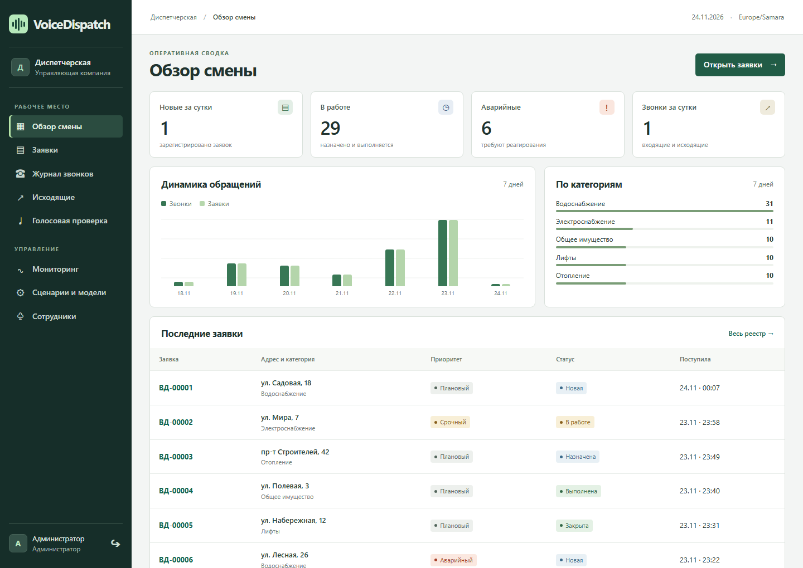
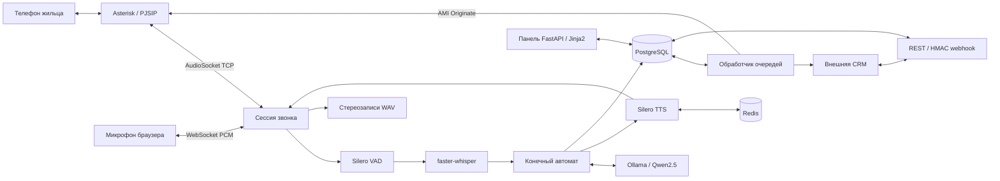

# VoiceDispatch

Локальная голосовая диспетчерская для управляющей компании ЖКХ. При входящем звонке ассистент выясняет причину обращения, адрес, квартиру, имя и телефон. Житель слышит собранные данные и подтверждает регистрацию. Диспетчер получает карточку с приоритетом, записью разговора и историей обработки.



## Работа смены

- **Приём звонка.** У каждой линии собственное состояние VAD, очередь реплик и запись. Начало речи жителя прерывает воспроизведение ответа.
- **Аварийное обращение.** Фразы вроде «запах газа» и «прорвало трубу» переводят диалог в аварийную ветку. Ассистент сохраняет имеющиеся сведения. На телефонной линии управление возвращается в диалплан для соединения с дежурным. Явная просьба соединить с оператором также завершает автоматический опрос.
- **Заявка.** Диспетчер меняет приоритет, назначает исполнителя и ведёт заявку до выполнения. Версия карточки защищает от потери изменений при одновременном редактировании.
- **Контроль качества.** Для выполненной заявки с согласием жителя диспетчер назначает дату и время звонка. Подтверждение закрывает заявку, замечание возвращает её в работу. После трёх неудачных попыток очередь фиксирует окончательный результат.
- **Контроль смены.** Панель показывает поток звонков и заявок, категории, аварийные обращения и длительность этапов обработки. Доступ к настройкам и созданию пользователей предоставляется администраторам.

[Реестр заявок](docs/screens/tickets.png) · [Карточка обращения](docs/screens/ticket.png)

## Развёртывание

Потребуются Docker с Compose, Python 3.11 для подготовки конфигурации и подключения к источникам весов при установке. Конфигурация рассчитана на один экземпляр приложения и CPU. SIP-транк и Asterisk подключаются отдельно. Браузерный микрофон позволяет начать работу без АТС.

```sh
git clone https://github.com/gregory-237/voice-dispatch.git
cd voice-dispatch
python scripts/configure.py
python scripts/models.py --asr small
docker compose up -d db redis ollama
docker compose exec ollama ollama pull qwen2.5:3b
docker compose up -d --build app
```

Откройте **http://localhost:8080**. Первый пользователь — `admin`, пароль находится в `ADMIN_PASSWORD` файла `.env`. Установщик генерирует индивидуальные секреты и при повторном вызове сохраняет существующий файл. Миграции выполняются при запуске контейнера. Создайте отдельные учётные записи для сотрудников в разделе «Сотрудники».

Для заполнения **пустого** реестра синтетическими обращениями выполните `docker compose exec app python -m dispatch.seed`. Именно эти данные показаны на скриншотах. Команда создаёт только завершённые задания обратного звонка.

## Архитектура



Входящий звук — PCM16 LE, mono, 8 кГц. Silero VAD работает на телефонной частоте. Для ASR сигнал пересчитывается в 16 кГц. Ollama возвращает поток JSON, после завершения объекта Pydantic проверяет поля. Порядок вопросов, согласие жителя, подтверждение и переходы статуса определяет код. TTS синтезирует ответ по предложениям и отдаёт его порциями по 20 мс. Кэш хранит повторяющиеся служебные реплики.

## Голосовая проверка в браузере

Откройте «Голосовая проверка», нажмите «Начать разговор» и разрешите микрофон. На удалённом рабочем месте нужен HTTPS с проксированием WebSocket; на localhost доступен HTTP. Используйте наушники, чтобы уменьшить обратную связь. Принятое голосовое обращение попадёт в общий реестр. Роль наблюдателя имеет доступ для чтения.

## Эксплуатация

| Задача | Действие |
| --- | --- |
| Состояние процесса и БД | `GET /health`, `docker compose ps` |
| Задержки распознавания, извлечения и синтеза | Раздел «Мониторинг», выборка за последние 24 часа. Время ожидания обработки включено. Попадания в кэш показаны отдельно |
| Приветствие, пауза VAD, модель Qwen и голос | «Сценарии и модели»; изменения применяются к новым разговорам |
| Логи | `docker compose logs -f app`. События голосового движка содержат UUID сеанса |
| Записи | `var/audio/<uuid>.wav`, левый канал — житель, правый — ассистент |
| Резервная копия БД | `sh scripts/backup.sh` из корня репозитория. Архив custom format появится в `var/backups/` |
| Восстановление | В отдельной пустой базе выполните `pg_restore -d dispatch_restore dispatch.dump`. Для аудио сохраняйте каталог `var/audio` отдельно |
| Часовой пояс интерфейса | `TIMEZONE` в .env. Даты API и очередей сохраняются в UTC |

По умолчанию порты опубликованы на loopback. Для рабочего контура разместите HTTPS-прокси перед панелью, установите `SECURE_COOKIE=true`, ограничьте доступ к AudioSocket и AMI адресами АТС и приложения. Политика организации определяет сроки хранения записей, транскриптов и резервных копий. Для замены пароля первичного пользователя после первого входа используется отдельная команда `python -m dispatch.password admin` внутри контейнера.

## Интеграции и инструменты

- [Подключение Asterisk и маршрутизация вызовов](docs/asterisk.md)
- [Установка локальных моделей](docs/models.md)
- [REST API и подпись webhook](docs/api.md)
- [Симулятор и измерение задержек](docs/transport.md)

Лицензия исходного кода — [MIT](LICENSE). Условия использования весов определяются их поставщиками.
